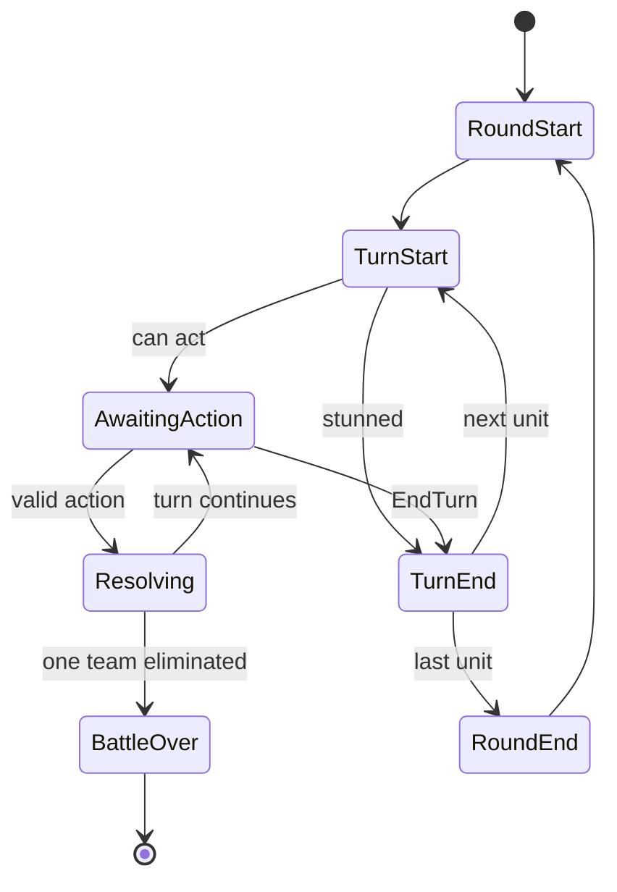
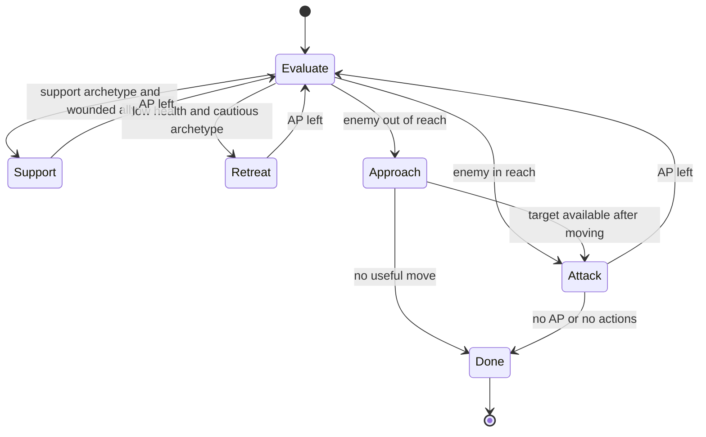
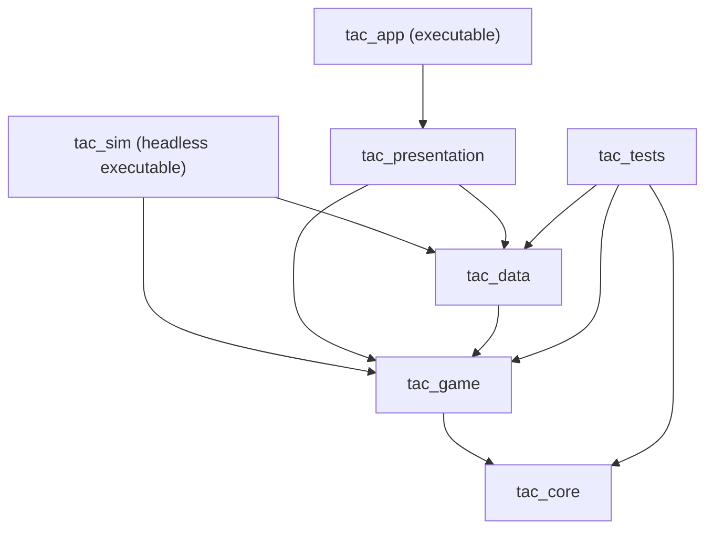
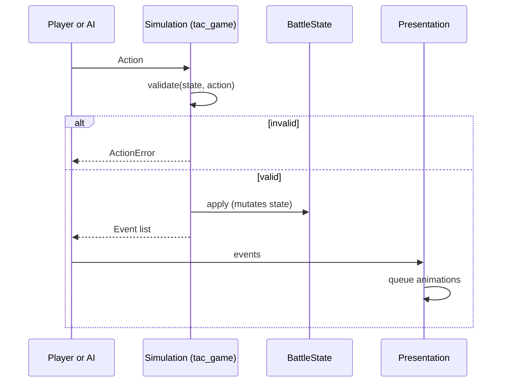

# Tactics RPG

[](https://github.com/adezazapata/tactics-rpg-cpp/actions/workflows/ci.yml)


A turn-based tactical RPG written in **C++20**. The game logic is a **deterministic, headless simulation** fully separated from the presentation layer. All game content (abilities, status effects, units, encounters) is **data-driven** and defined in JSON. AI-controlled units use exactly the same actions and validation as the player.

> **Portfolio project.** This repository is public so that the code can be read and evaluated. It is **not open source** and it is **not accepting contributions**. See [License](#license) and [Contributions](#contributions).

---

## Table of contents

- [Features](#features)
- [Platform support](#platform-support)
- [Building](#building-windows)
- [Gameplay rules](#gameplay-rules)
- [Architecture](#architecture)
- [Data format](#data-format)
- [Testing](#testing)
- [Continuous integration](#continuous-integration)
- [Performance targets](#performance-targets)
- [Key design decisions](#key-design-decisions)
- [Repository layout](#repository-layout)
- [Tech stack](#tech-stack)
- [Contributions](#contributions)
- [License](#license)

---

## Features

- Grid-based combat with **initiative order**, action points (AP) and movement points.
- **Data-driven ability system**: cost, range, line of sight, area of effect, cooldown and a list of effects.
- **Status effects** with duration, stacking policies, stat modifiers, per-turn damage/healing, stun and root.
- **A\* pathfinding** and reachable-tile calculation with per-terrain movement cost.
- **AI** built from a finite state machine plus action scoring, with three archetypes: melee, ranged and support.
- **Deterministic simulation**: the same seed and the same actions always produce the same event log.
- **Save/load** of a battle as a versioned JSON snapshot.
- UI built with raylib and Dear ImGui: board, path preview, ability bar, unit panel, combat log and debug panel.
- `tac_sim`, a headless executable that simulates AI-vs-AI battles in bulk.

## Platform support

- **Windows 10/11 (x64, MSVC)**
- **Linux (GCC / Clang)**

The simulation modules (`tac_core`, `tac_game`, `tac_data`) have no platform-specific code and no external dependencies beyond the standard library and a JSON parser, which keeps the Linux port small.

## Gameplay rules

### Turns

- Turn order is computed at the start of the battle: initiative descending, ties broken by ascending unit id.
- At the start of its turn a unit refills AP and movement points.
- Moving one tile costs the tile's movement cost; using an ability costs its AP.
- A turn ends with an explicit `EndTurn` action (the AI emits it when it has no useful action left).
- Dead units are skipped.
- A battle ends when one team has no living units. A **maximum round limit** ends the battle in a draw, so AI-vs-AI simulations can never loop forever.



### Abilities

An ability validates, in this order: it is the unit's turn, the unit is alive and not stunned, enough AP, not on cooldown, valid target type and filter, distance within `[minRange, maxRange]` (Manhattan), and line of sight if required. Line of sight uses Bresenham's algorithm and is blocked by opaque terrain. Area of effect is a diamond of radius `aoeRadius`, clipped by walls.

### Damage (integer arithmetic only)

| Step | Operation |
|---|---|
| 1. Raw | `raw = base + stat * scalingPercent / 100` |
| 2. Flat mitigation | `Physical`: `mitigated = raw - defense`; other types: `mitigated = raw` |
| 3. Resistance | `final = max(1, mitigated * (100 - resist[type]) / 100)` |
| 4. Apply | `hp = max(0, hp - final)`, emit event, check death |

### Status effects

| Moment | Behaviour |
|---|---|
| Applied | Starts with its full duration, even if applied mid-turn |
| Start of the owner's turn | `onTurnStart` effects run; a stunned unit skips its turn |
| End of the owner's turn | Duration decreases by 1; at 0 the status expires and an event is emitted |
| Re-applied | `Refresh` restores duration, `Stack` adds a stack up to `maxStacks`, `Ignore` does nothing |

### Terrain

| Terrain | Walkable | Movement cost | Blocks line of sight |
|---|---|---|---|
| `floor` | Yes | 1 | No |
| `mud` | Yes | 2 | No |
| `wall` | No | n/a | Yes |

### Pathfinding

- **A\*** with Manhattan heuristic (admissible while the minimum tile cost is 1), 4-directional movement.
- **Dijkstra** limited by movement points for reachable tiles (variable costs rule out plain BFS).
- Deterministic tie-breaking by `(f, h, index)`.
- Walls and occupied tiles (allied or enemy) block movement.
- A reusable scratch buffer avoids heap allocations in the hot path.

### AI

Two levels: a **state machine** picks the unit's intent and a **scoring function** picks the concrete action.



Each candidate is a `(destination tile, ability, target)` triple generated from the reachable tiles and scored by expected damage, kill bonus, distance to the archetype's preferred position, threat at the destination and useful healing.

| Archetype | Behaviour |
|---|---|
| `melee` | Targets the weakest reachable enemy and moves adjacent |
| `ranged` | Keeps a distance close to its maximum range and avoids adjacency |
| `support` | Heals the most wounded ally; attacks if nobody is wounded |

The AI only emits `Action` values and goes through the same `validate` as the player. It is deterministic: ties are resolved in a stable order and any randomness uses the battle's own RNG.

## Architecture



| Module | Contents |
|---|---|
| `tac_core` | `GridPos`, `StrongId`, random number generator, `Result`, assertions, logging |
| `tac_game` | Definitions, battle state, systems (turns, abilities, statuses, pathfinding, line of sight), actions, events, AI |
| `tac_data` | JSON loading and validation, save/load |
| `tac_presentation` | Rendering, input, HUD, animation queue, event player, debug panel |

`tac_core` and `tac_game` depend on nothing external. This is enforced in CMake: those targets do not link raylib or JSON, so a stray `#include` breaks the build.

**Action flow.** Player or AI submits an `Action` (a closed `std::variant`: `MoveAction`, `UseAbilityAction`, `EndTurnAction`). The simulation validates it, applies it to the `BattleState` and returns a vector of `Event` values. The presentation consumes those events at its own pace to drive animations; the simulation never waits for graphics.



**Memory and ownership**

| Data | Policy |
|---|---|
| Battle state | Value types in standard containers |
| References between entities | Strongly typed ids (`UnitId`, `AbilityId`...), never raw pointers |
| Read-only views | `std::span` and `const&` |
| Polymorphism | Avoided in the simulation (`std::variant`) |
| raylib resources | RAII wrappers |
| Manual `new` / `delete` | Not used (checked by `clang-tidy`) |

**Error handling:** invalid actions return `std::optional<ActionError>`; data errors return a `Result<T>` with readable messages; internal invariants use `TAC_ASSERT`; the simulation does not use exceptions.

## Data format

Content lives in `data/` as JSON. Adding an ability or a status effect does not require recompiling. Content ids are strings in the files and are interned to typed ids once at load time.

```json
{
  "version": 1,
  "abilities": [
    {
      "id": "fireball",
      "name": "Fireball",
      "ap_cost": 3,
      "cooldown": 2,
      "range": { "min": 2, "max": 6 },
      "target": "tile",
      "filter": "any",
      "needs_los": true,
      "aoe_radius": 1,
      "effects": [
        { "type": "damage", "damage_type": "fire", "base": 8,
          "scaling": { "stat": "magic", "percent": 50 } },
        { "type": "apply_status", "status": "burning", "duration": 2 }
      ]
    }
  ]
}
```

Loading validates required fields and types, cross-references (every ability of a unit, every status applied by an ability and every unit in an encounter must exist), duplicate ids, coherent ranges, positions inside the map and the `version` field. Errors report the file, the JSON path and the reason.

Save files are full snapshots of the battle state in JSON, with a `version` field and the complete RNG state.

## Testing

| Level | What it covers | Tool |
|---|---|---|
| Unit | Grid, turn order, action validation, damage pipeline, status stacking, JSON loading | Catch2 |
| Data | Invalid files: missing field, broken reference, duplicates, unknown version | Catch2 |
| Property-style | A\* cost compared against a reference Dijkstra on seeded random maps | Catch2 |
| Golden | Seeded battle whose event log is compared with a stored file in `tests/golden/` | Catch2 |
| Soak | Thousands of AI-vs-AI battles checking invariants | `tac_sim` under AddressSanitizer |
| Persistence | `save(load(save(s))) == save(s)`; save/load mid-battle yields the same event log as an uninterrupted run | Catch2 |
| Benchmarks | Pathfinding and AI evaluation | Catch2 `BENCHMARK` |

Invariants checked by the soak runs: no two units share a tile; `0 <= hp <= maxHp` and `ap >= 0` at all times; a dead unit occupies no tile and never acts; every battle terminates; every event references existing units.

## Continuous integration

- **Windows (MSVC):** build, unit tests, and AddressSanitizer runs, on every push and pull request.
- **Linux (GCC and Clang):** planned together with the Linux port, adding UBSan and `clang-tidy` checks.

Warnings are treated as errors.

## Key design decisions

| # | Decision | Rejected alternative |
|---|---|---|
| D1 | Simulation separated from presentation | Logic inside graphical entities |
| D2 | Actions as a closed `std::variant` | Virtual class hierarchy |
| D3 | Strongly typed ids | Raw pointers or runtime strings |
| D4 | Units are never removed from the vector (`alive` flag) | Erase on death |
| D5 | Integer arithmetic in the simulation | `float` |
| D6 | Own PRNG (PCG/xoshiro) | `std::mt19937` with `std::uniform_*_distribution`[^prng] |
| D7 | 4-directional movement | 8 directions |
| D8 | Units block movement (allied and enemy) | Passing through allies |
| D9 | Events as simulation output | Callbacks from game logic |

[^prng]: The distributions in the standard library are not guaranteed to produce the same sequence across implementations, which breaks cross-platform reproducibility.

## Repository layout

```
tactics-rpg/
├─ CMakeLists.txt
├─ CMakePresets.json
├─ cmake/                   warnings, sanitizers, dependencies
├─ src/
│  ├─ core/                 grid_pos, strong_id, rng, result, assert, log
│  ├─ game/                 defs, state, systems, actions, events, ai
│  ├─ data/                 json loading, validation, save/load
│  ├─ presentation/         renderer, hud, input, animations, debug panel
│  ├─ sim/                  tac_sim (headless simulator)
│  └─ app/                  main.cpp
├─ data/                    abilities, statuses, units, encounters
├─ tests/                   unit tests and golden files
├─ bench/                   benchmarks
└─ docs/                    architecture notes and decision records
```

## Tech stack

| Area | Choice |
|---|---|
| Language | C++20 |
| Build | CMake 3.25+ with `CMakePresets.json` |
| Window and rendering | raylib |
| UI | Dear ImGui (via rlImGui) |
| JSON | nlohmann/json |
| Tests | Catch2 v3 |
| Dependencies | CMake `FetchContent`, pinned versions |
| Tooling | `clang-format`, `clang-tidy`, warnings as errors |

## Contributions

This repository is **not accepting contributions**. Issues, discussions and the wiki are disabled, and pull requests are restricted to the repository owner.

## License

This project is **source-available under a view-only license**; it is not open source. You may read the code and, for personal study and evaluation of the author's work, clone, compile and run it locally. Copying, reusing, modifying for distribution, redistributing and commercial use require prior written permission from the author. See [LICENSE](LICENSE) for the full terms.

Third-party libraries (raylib, Dear ImGui, nlohmann/json, Catch2) are downloaded at build time and remain under their own licenses.
